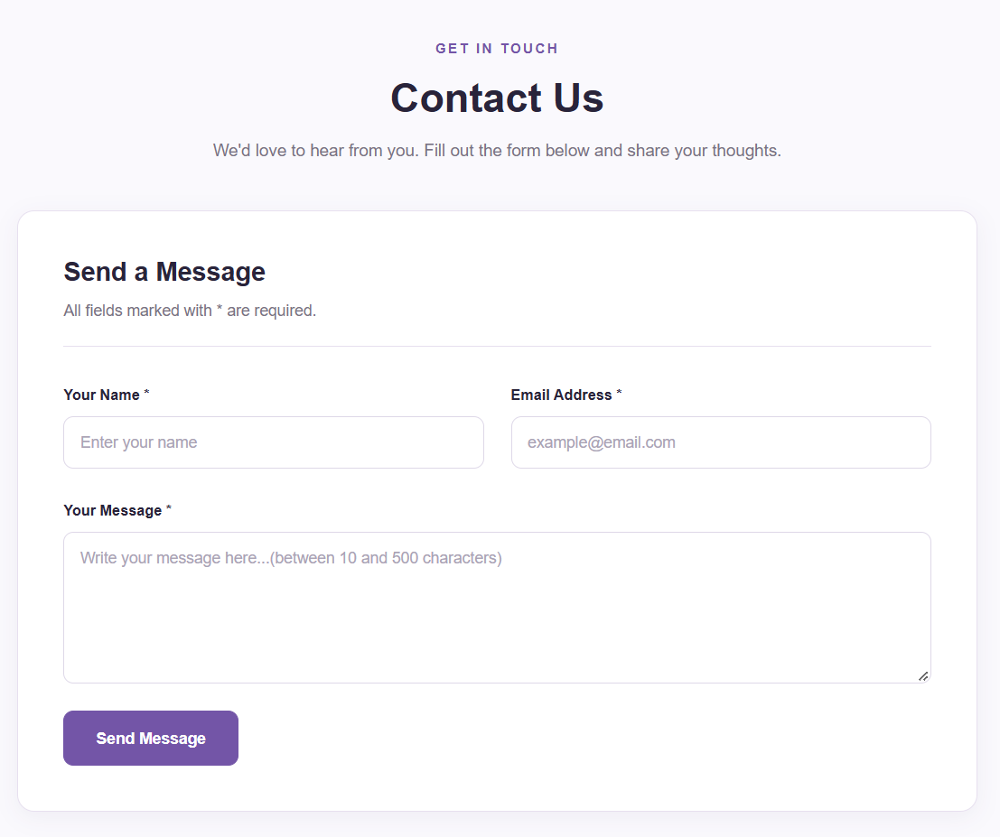
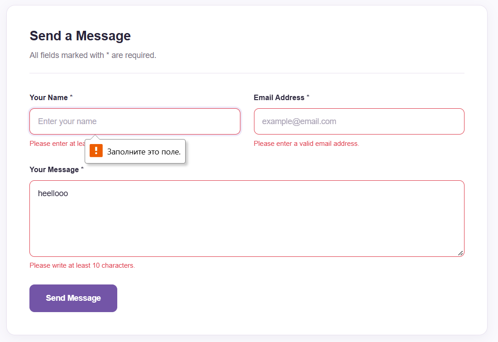
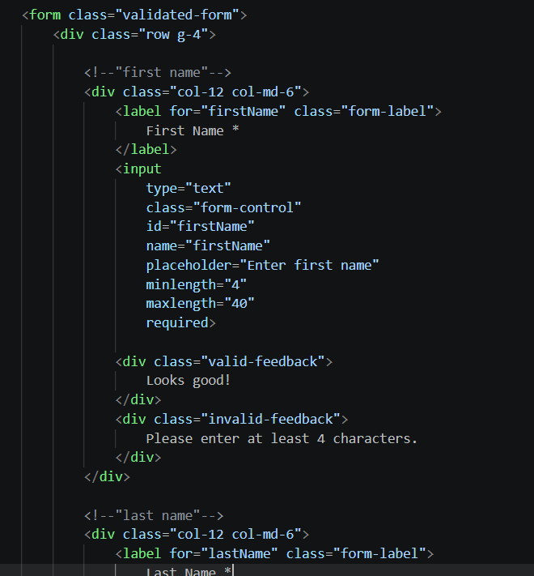
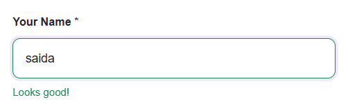
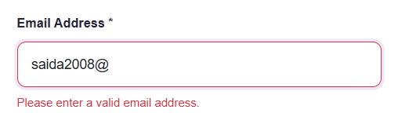
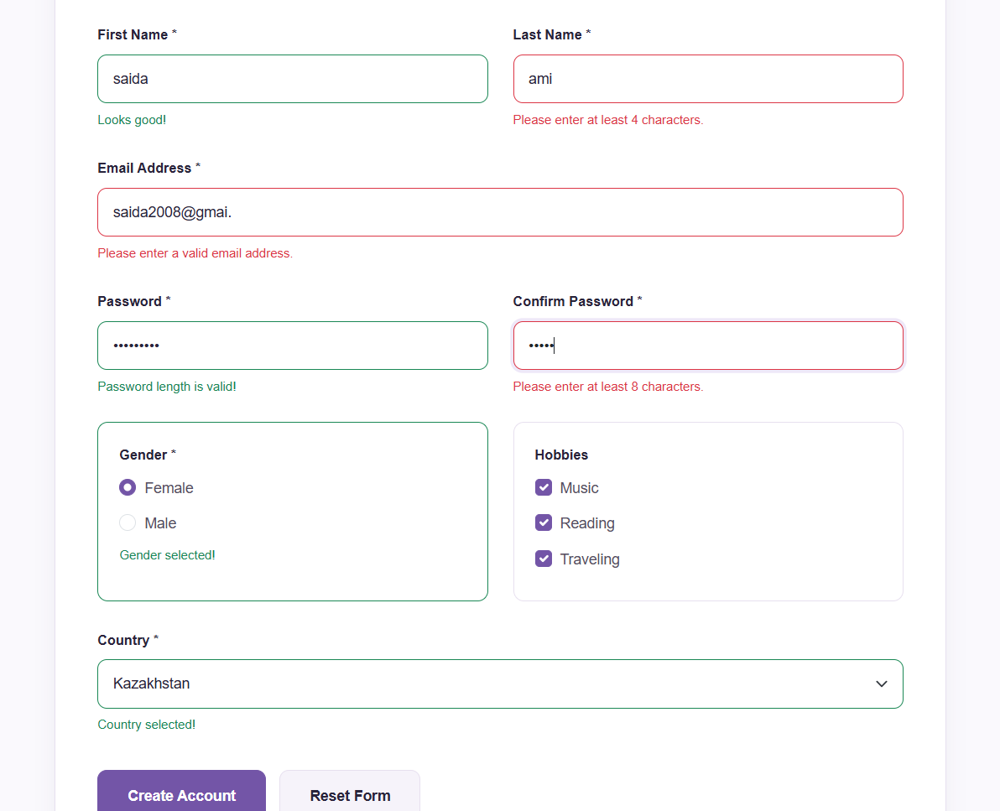

# Assignment 4 — Forms and Validation

Student Information:
Name: Saida Amirgaliyeva
Group: IT-2513

Project Description:
FormLab is a responsive website with a contact form and a registration form. The project demonstrates HTML5 form validation, Bootstrap form components, and responsive design.

-

Part 1. Basic HTML Forms
Task 0. Simple Contact Form
I created a contact form with Name, Email, Message, and Submit button. Each input has a label.

Task 1. Form with HTML5 Validation
I added HTML5 validation using required, minlength, maxlength, and email input type. The browser checks the input before submitting the form.

Part 2. Bootstrap Forms
Task 2. Bootstrap Form Styling
I styled the contact form using Bootstrap classes such as form-control, form-label, and form-text. I used Bootstrap Grid to make the form responsive.

Task 3. Bootstrap Validation Styles
I added validation feedback messages for correct and incorrect input. The form displays green borders and success messages for valid input, and red borders and error messages for invalid input.

Part 3. Advanced Form Project
Task 4. Registration Form
I created a registration form with:
- First Name and Last Name
- Email
- Password and Confirm Password
- Gender radio buttons
- Hobbies checkboxes
- Country dropdown
- Submit and Reset buttons
I used Bootstrap Grid for responsive layout and HTML5 validation for required fields and password length.

Technologies Used
- HTML5
- CSS3
- Bootstrap 5.3.3

Work Process Summary:
First, I created the HTML structure and contact form. Then, I added HTML5 validation and Bootstrap styling. After that, I added validation feedback messages and created the registration form. Finally, I used CSS and Bootstrap Grid to make the website responsive and tested the forms with valid and invalid data.
